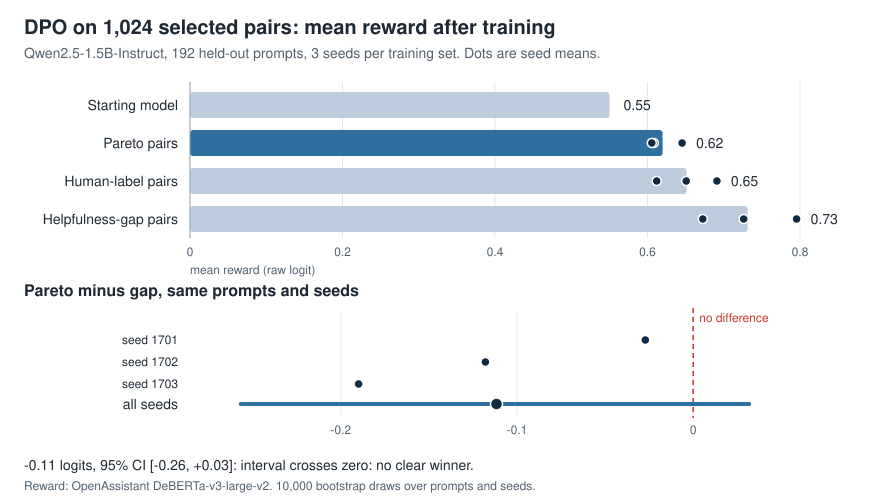
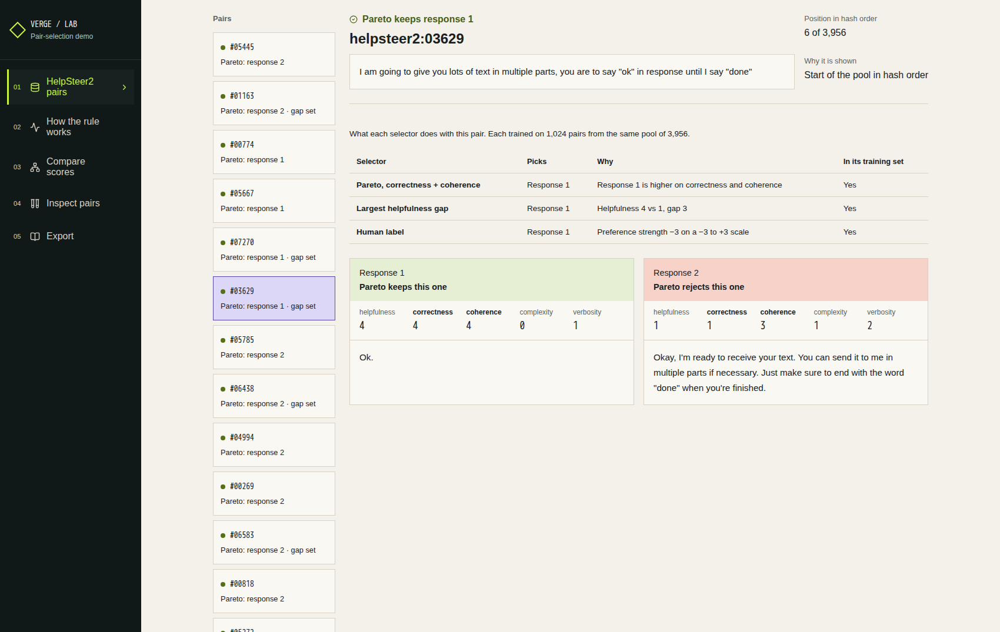

# Verge Lab

Verge Lab picks DPO preference pairs by Pareto dominance, keeping a pair only when one answer is at least as good on every score and clearly better on at least one, and abstaining on trade-offs, near ties and missing scores.

I trained nine LoRA adapters on Qwen2.5-1.5B-Instruct to compare it with the simplest alternative, taking the pairs with the largest helpfulness gap. Pareto scored lower on all three seeds, 0.11 reward-model logits below gap on average, although the 95% interval (−0.26 to +0.03) still includes a tie.



| Training pairs (1,024 each) | Mean reward | Beats starting model | Avg. answer length |
| --- | ---: | ---: | ---: |
| none (starting model) | 0.55 | n/a | 160 tokens |
| Pareto on correctness + coherence | 0.62 | 50% | 162 |
| Human preference labels | 0.65 | 50% | 160 |
| Largest helpfulness gap | 0.73 | 55% | 158 |

Reward is the raw logit of [OpenAssistant's DeBERTa reward model](https://huggingface.co/OpenAssistant/reward-model-deberta-v3-large-v2) on 192 held-out HelpSteer2 prompts. It correlates with answer length (r = 0.33) and every condition's median answer hits the 192-token cap, so treat it as a proxy. Pareto answers run about 4 tokens longer than gap answers.

The two selectors pick mostly different data: only 330 of their 1,024 pairs overlap. On HelpSteer2 validation pairs where annotators had a preference, both agree with the human label about 98% of the time. Training and scoring all nine adapters cost under $5 of L4 time on Modal.

## Using the selector

```bash
uv sync --locked --dev
uv run verge analyze examples/candidates.json --output artifacts/my-run.json
uv run verge export-dpo artifacts/my-run.json --output artifacts/my-run.dpo.jsonl
```

You supply the scores, since the package runs no model, and the export is TRL-ready DPO JSONL. A confidence penalty can shrink the margins of uncertain scores (the experiment sets confidence to 1), and [`verge_lab/pareto.py`](verge_lab/pareto.py), which implements the rule, is about 200 lines.

To redo the analysis from the saved rewards (10,000 bootstrap resamples over prompts and seeds, plus the figure):

```bash
uv run python tools/analyze_day_dpo.py --output-dir .cache/dpo
```

Retraining needs a Modal account, and the data selection, training settings and exact selection rule are described in [docs/experiment.md](docs/experiment.md).

## Demo

[](https://mottopanikeiku.github.io/verge-lab/)

The [demo](https://mottopanikeiku.github.io/verge-lab/) opens on 40 real training pairs from the experiment: the prompt, both HelpSteer2 responses, the annotators' ratings, and what the Pareto, gap and human-label selectors did with each pair, including whether it made each 1,024-pair training set. The other views walk through the rule's confidence penalty, near-tie threshold and export on made-up scores. `npm ci && npm run dev` runs it locally, and `uv run python tools/export_demo_pairs.py` rebuilds the pair file from the saved results.

The data is [HelpSteer2](https://arxiv.org/abs/2406.08673) and [HelpSteer2-Preference](https://arxiv.org/abs/2410.01257) (NVIDIA, CC-BY-4.0), and the adapters train with the [DPO](https://arxiv.org/abs/2305.18290) loss on Qwen2.5 (Apache-2.0). The earlier rating study in `results/public-preferences/` uses [UltraFeedback](https://arxiv.org/abs/2310.01377) on [TruthfulQA](https://arxiv.org/abs/2109.07958), and the code is MIT licensed.
